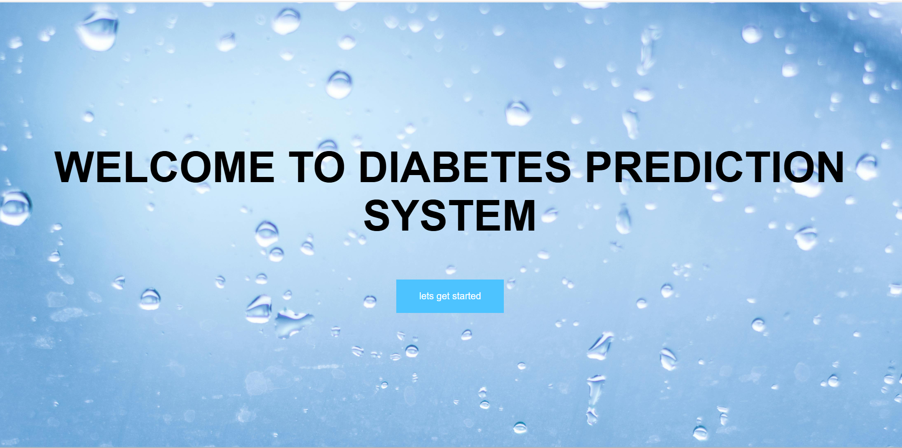
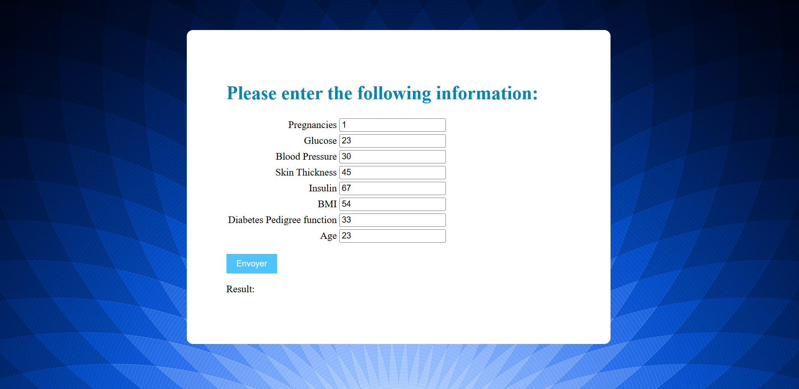
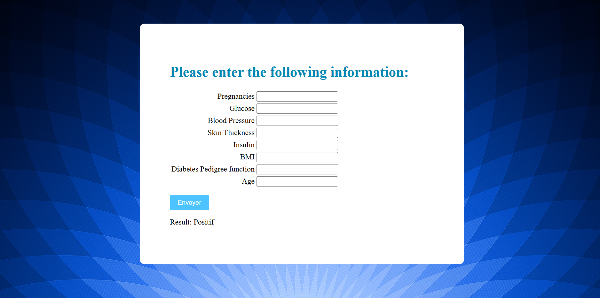

# Diabetes Prediction System

### Machine Learning-Based Diabetes Prediction Web Application

A Django web application that uses a trained machine learning model to predict a binary diabetes-related outcome from eight health measurements.

The project demonstrates how a serialized machine learning model can be integrated into a Python web application to accept user inputs and display a prediction.




## Project Overview

The application provides a simple interface for entering eight numerical health-related features. A trained classification model is loaded from a Pickle file and used to generate a binary prediction, displayed as **Positif** or **Negatif**.

The application includes:

1. A homepage introducing the prediction system.
2. A form collecting eight numerical input values.
3. A Django view that loads the trained model and performs inference.
4. A result displayed directly on the prediction page.

## Project Objectives

- Build a web interface for a machine learning classification model.
- Collect eight numerical input features from users.
- Load a previously trained model using Python Pickle.
- Generate and display a binary prediction with Django.
- Demonstrate the integration of machine learning and web development.

## Technologies Used

| Category | Technologies |
|---|---|
| Programming language | Python |
| Web framework | Django |
| Machine learning | Scikit-learn |
| Model serialization | Pickle |
| Frontend | HTML, CSS |
| Data analysis / experimentation | Pandas, Matplotlib, Seaborn (imported in the original project code) |
| Version control | Git, GitHub |

## Prediction Inputs

The application uses the following eight input features:

| Feature | Description |
|---|---|
| Pregnancies | Number of pregnancies |
| Glucose | Glucose measurement |
| Blood Pressure | Blood pressure measurement |
| Skin Thickness | Skin thickness measurement |
| Insulin | Insulin measurement |
| BMI | Body mass index |
| Diabetes Pedigree Function | Family-history-related diabetes risk score |
| Age | Age |

## Prediction Workflow

```text
           User
             |
             v
    Enter 8 health values
             |
             v
       Django form
             |
             v
    Read numerical inputs
             |
             v
   Load serialized ML model
  (diabete_prediction_model.pkl)
             |
             v
      Model prediction
             |
             v
  Display Positif / Negatif
```

### Prediction Form

The prediction form lets users enter values for all eight features before submitting a prediction request.




### Prediction Result

After the form is submitted, the application loads the saved model, processes the eight numerical values, and displays the predicted class as **Positif** or **Negatif**.



